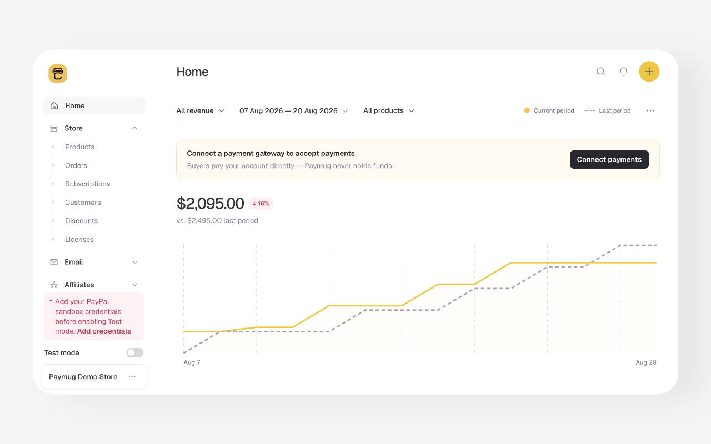

# Paymug

Paymug is a self-hosted Lemon Squeezy / Polar alternative for selling digital products
and subscriptions. Connect PayPal or Stripe, get paid directly, and manage your
store from one dashboard.

Built with Next.js 16, Tailwind CSS, Cloudflare D1, and Drizzle ORM.

[](https://deploy.workers.cloudflare.com/?url=https://github.com/Paymug/paymug)




## Links and demo access

| Demos | URL | Login |
|------|-----|-------|
| Storefront | [demo.paymug.co](https://demo.paymug.co) | — |
| Admin | [demo.paymug.co/dashboard](https://demo.paymug.co/dashboard) | `demo@paymug.co` / `demo1234` |
| Customer | [demo.paymug.co/customer](https://demo.paymug.co/customer) | `demo@paymug.co` / `demo1234` |

## Features

- **Sell your way** — storefront, hosted checkout, one-time products, subscriptions, and pay-what-you-want pricing
- **Get paid directly** — connect PayPal, Stripe, or SEPay with sandbox and live modes
- **Automatic tax** — enable Stripe Tax from **Settings → Tax**
- **Leave Lemon Squeezy, Polar, Paddle or Dodo Payments for free** — import your catalog, files, customers, orders, license keys, discounts and subscriptions from **Settings → Migrate**, with license API shims so your apps keep validating
- **Deliver automatically** — files, license keys, and private GitHub access
- **Sell extra seats** — per-product seat add-ons at checkout, and customers can buy more seats later from the buyer portal
- **Grow sales** — discounts, email campaigns, affiliates, and abandoned-checkout recovery
- **Run everything in one place** — customers, orders, refunds, analytics, notifications, per-user time zones, and a buyer portal
- **Own your stack** — self-host on Cloudflare and extend with scoped API keys
- **AI-ready** — built-in MCP server (`POST /api/mcp`) so agents can manage products, orders, customers, and more, limited by the API key's permissions

See the [changelog](changelog/README.md) for recent updates.

## Quick start

```bash
npm install
cp .env.example .env.local   # optional — defaults work for local dev

# Apply D1 schema to the local Miniflare SQLite file
npm run db:migrate:local

npm run dev
```

Open [http://localhost:3000](http://localhost:3000).

### Database commands

| Script | Purpose |
|--------|---------|
| `npm run db:generate` | Generate SQL migrations from `src/db/schema.ts` |
| `npm run db:migrate:local` | Apply migrations to local D1 |
| `npm run db:migrate:remote` | Apply migrations to remote D1 (needs real `database_id`) |

Schema: `src/db/schema.ts` · Client: `src/db/index.ts` · Queries: `src/lib/db.ts`

## Configure payments (seller)

Payment credentials are read from environment variables and are **never saved
to the database**. The dashboard is used only to choose which provider
customers see at checkout.

1. Create a PayPal app at [developer.paypal.com](https://developer.paypal.com)
   (or a Stripe account at [dashboard.stripe.com](https://dashboard.stripe.com)).
2. Set the provider credentials as environment variables on the deployment
   (see the Environment table below for the exact names; one set for sandbox
   and one for live).
3. In Paymug: **Dashboard → Payments** → choose the active provider and click
   **Set up webhook automatically** for sandbox/live (creates the PayPal
   webhook pointing at the app; requires a public HTTPS app URL). For Stripe,
   create the webhook endpoint in the Stripe dashboard and set
   `STRIPE_*_WEBHOOK_SECRET`.
4. Publish a product and open its checkout link.

Use [sandbox buyer accounts](https://developer.paypal.com/dashboard/accounts)
or Stripe test keys to test purchases.

## Seller flow

1. Sign up → store created  
2. Connect PayPal  
3. Create & publish products  
4. Share `/buy/{id}` or the storefront homepage `/`  
5. Buyer pays **your** PayPal → order marked paid → delivery content shown  

## API surface (high level)

| Method | Path | Purpose |
|--------|------|---------|
| POST | `/api/auth/signup` | Create merchant |
| POST | `/api/auth/login` | Session login |
| GET/POST | `/api/products` | List / create products |
| GET | `/api/payments/paypal/connect` | PayPal credential status (from env) |
| POST | `/api/payments/paypal/create-order` | Create PayPal order (buyer) |
| POST | `/api/payments/paypal/capture-order` | Capture payment |
| POST | `/api/payments/stripe/create-session` | Create Stripe checkout session |
| POST | `/api/payments/sepay/create-session` | Create SEPay checkout session |
| GET/PATCH | `/api/settings/tax` | Read / update Stripe Tax setting |
| POST/GET | `/api/settings/migrate/lemonsqueezy/{connect,preview,start,status,cancel}` | Lemon Squeezy import (session or `migrations:write` key) |
| POST/GET | `/api/settings/migrate/{polar,paddle,dodo}/{connect,preview,start,status,cancel}` | Polar, Paddle and Dodo Payments import (same auth) |
| POST | `/api/compat/lemonsqueezy/v1/licenses/{validate,activate,deactivate}` | Lemon Squeezy license API shim |
| POST | `/api/compat/polar/v1/customer-portal/license-keys/{validate,activate,deactivate}` | Polar license API shim |
| POST | `/api/compat/dodo/licenses/{validate,activate,deactivate}` | Dodo Payments license API shim |
| GET | `/api/v1/{products,orders,customers}` | Public API (scoped API key) |
| POST | `/api/mcp` | MCP server (scoped API key) |

API keys carry per-resource read / write / delete scopes — see
[`docs/guides/api-keys.md`](docs/guides/api-keys.md).

## Environment

| Variable | Description |
|----------|-------------|
| `AUTH_SECRET` | JWT session signing key |
| `ENCRYPTION_SECRET` | Encrypts integration secrets at rest |
| `NEXT_PUBLIC_APP_URL` | Absolute origin for PayPal/Stripe return and webhook URLs |
| `PAYMUG_LICENSE_API_URL` | Paymug license activation and validation origin (defaults to `https://api.paymug.co`) |
| `PAYPAL_SANDBOX_CLIENT_ID` | PayPal sandbox app Client ID |
| `PAYPAL_SANDBOX_CLIENT_SECRET` | PayPal sandbox app Client Secret |
| `PAYPAL_LIVE_CLIENT_ID` | PayPal live app Client ID |
| `PAYPAL_LIVE_CLIENT_SECRET` | PayPal live app Client Secret |
| `STRIPE_SANDBOX_SECRET_KEY` | Stripe test secret key (`sk_test_…`) |
| `STRIPE_SANDBOX_WEBHOOK_SECRET` | Stripe test webhook signing secret (`whsec_…`) |
| `STRIPE_LIVE_SECRET_KEY` | Stripe live secret key (`sk_live_…`) |
| `STRIPE_LIVE_WEBHOOK_SECRET` | Stripe live webhook signing secret (`whsec_…`) |
| `SEPAY_SANDBOX_MERCHANT_ID` / `SEPAY_SANDBOX_SECRET_KEY` / `SEPAY_SANDBOX_IPN_SECRET` | SEPay sandbox credentials |
| `SEPAY_LIVE_MERCHANT_ID` / `SEPAY_LIVE_SECRET_KEY` / `SEPAY_LIVE_IPN_SECRET` | SEPay live credentials |
| `EMAIL_FROM` | Verified Paymug sender on your Cloudflare Email Service domain |
| `EMAIL_REPLY_TO` | Optional customer reply address |
| `GITHUB_CLIENT_ID` | GitHub OAuth App client ID |
| `GITHUB_CLIENT_SECRET` | GitHub OAuth App client secret |

Set the GitHub OAuth App callback URL to
`<NEXT_PUBLIC_APP_URL>/api/github/oauth/callback`.

`AUTH_SECRET`, `ENCRYPTION_SECRET`, and `NEXT_PUBLIC_APP_URL` are required at
runtime: the app fails closed (session signing, secret decryption, and URL
construction refuse to run) instead of falling back to a default or to the
request `Host` header.

## Cloudflare Email Service

1. In Cloudflare, open **Compute → Email Service → Email Sending** and onboard the sending domain.
2. Use a Workers Paid plan when sending to arbitrary customer addresses.
3. Configure `EMAIL_FROM` with an address on the onboarded domain, plus optional `EMAIL_REPLY_TO`. Store addresses are used only for replies; merchant alerts go to the Paymug account email.
4. The `EMAIL` Worker binding is already declared in `wrangler.jsonc`.

## Deploy (Cloudflare)

Deploy Paymug to your Cloudflare account in one click:

[](https://deploy.workers.cloudflare.com/?url=https://github.com/Paymug/paymug)

The Cloudflare resources are intentionally not tied to the demo account. On the
first deployment, Wrangler provisions a D1 database and R2 bucket in the
deploying user's Cloudflare account. Each fork therefore has its own data and
product storage.

```bash
npm run deploy
```

The deploy command applies pending D1 migrations before building and deploying
the Worker.

## Private UserGitRepo setup and automatic updates

Cloudflare's Deploy to Cloudflare button clones its source into a new repository
in the deploying user's GitHub account and connects that repository to Workers
Builds. The button source must be public, but the newly created `UserGitRepo`
can be private. If the deployment must start directly from the private
`Paymug/paymug` repository, use Cloudflare's authenticated repository import
instead of a public Deploy button.

The update source is hardcoded as `Paymug/paymug`; users do not configure the
source or destination repository name. `GITHUB_REPOSITORY` identifies
`UserGitRepo` automatically inside GitHub Actions.

1. Give the purchaser's GitHub account read access to the private
   `Paymug/paymug` repository.
2. In `UserGitRepo`, open **Settings → Secrets and variables → Actions** and
   add one secret:

| Secret | Value |
|--------|-------|
| `UPSTREAM_TOKEN` | A GitHub credential belonging to that purchaser with Contents read access to `Paymug/paymug` |

3. Ensure GitHub Actions is enabled for `UserGitRepo`. The included workflow
   declares `contents: write`, so its repository-scoped `GITHUB_TOKEN` can push
   the merged update back to `UserGitRepo` without another token.

After setup:

- `.github/workflows/sync-upstream.yml` checks `Paymug/paymug/latest` every six
  hours and can also be run manually. It safely merges new upstream commits and
  pushes `UserGitRepo/main`.
- That push triggers the Cloudflare Workers Build already connected during the
  one-click deployment. The sync workflow does not deploy a second time.
- `/api/deployments` exposes the current official Paymug version.
  **Settings → About → Check for update** reads that endpoint.
- One-click update: set Worker variables `GITHUB_UPDATE_TOKEN` (fine-grained
  token with Actions read/write on `UserGitRepo`) and optionally
  `GITHUB_UPDATE_REPO` (`owner/repo`, defaults to the Git remote discovered at
  build) and `GITHUB_UPDATE_REF` (defaults to the repo default branch). When a
  newer version exists, **Update now** dispatches `sync-upstream.yml`.
  Without the token, the panel links to the workflow instead.
- Build metadata discovers `UserGitRepo` from the Git remote; no repository
  environment variable is required.
- A merge conflict stops the update instead of overwriting user changes.
  Resolve it in `UserGitRepo`, then rerun **Sync upstream updates**.
- `.github/workflows/deploy.yml` remains an optional manual fallback. It needs
  `CLOUDFLARE_ACCOUNT_ID` and `CLOUDFLARE_API_TOKEN`, but normal Workers Builds
  deployments do not.

Keep runtime application secrets such as `AUTH_SECRET`, `ENCRYPTION_SECRET`, and
payment credentials in Cloudflare. Automated deployments preserve variables and
secrets already configured on the Worker.

## Documentation

See [`docs/README.md`](docs/README.md) for developer, API, and AI-agent guides.
The documentation plan and completeness tracker are in
[`docs/DOCS.md`](docs/DOCS.md).